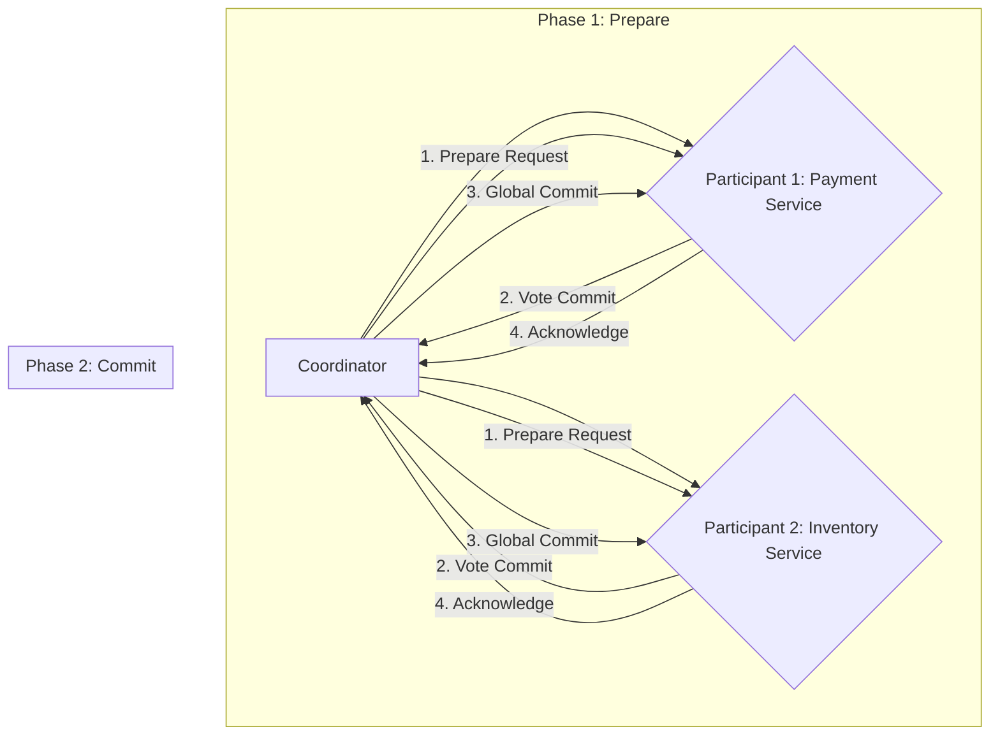

# Distributed Transactions & Two-Phase Commit (2PC)

In complex, distributed systems (e.g., microservices, multiple databases), maintaining data consistency across independent services is a significant challenge. Traditional ACID properties (Atomicity, Consistency, Isolation, Durability) are much harder to guarantee when a single business operation spans multiple resources.

## Why Distributed Transactions?

Consider a user purchasing an item:
1.  **Payment Service:** Debits user's account.
2.  **Inventory Service:** Decrements item stock.
3.  **Order Service:** Creates a new order.

If the payment succeeds but inventory update fails, the system is in an inconsistent state. A distributed transaction aims to ensure that either all these operations succeed (commit) or all fail (rollback) together, preserving atomicity.

## Two-Phase Commit (2PC)

2PC is a classic atomic commitment protocol that ensures all participants in a distributed transaction either commit or abort the transaction. It involves a central **coordinator** and several **participants** (resource managers).

### Roles:
*   **Coordinator:** Initiates the transaction, orchestrates participants, and makes the final commit/abort decision.
*   **Participant:** A resource manager (e.g., database, service) that performs the local transaction and votes on its outcome.

### Phases:

#### Phase 1: Prepare (Voting Phase)

1.  **Coordinator sends `prepare` request:** The coordinator sends a `prepare` message to all participants, along with transaction details.
2.  **Participants execute and vote:** Each participant:
    *   Executes the transaction locally (e.g., debit account, reserve stock) but does **not** commit it permanently.
    *   Writes all transaction changes to a local undo/redo log.
    *   Acquires necessary locks to ensure isolation.
    *   Responds with either:
        *   `Vote Commit`: If it successfully prepared and is ready to commit.
        *   `Vote Abort`: If it failed to prepare or cannot commit.

#### Phase 2: Commit (Decision Phase)

Based on the votes, the coordinator makes a global decision:

1.  **Global Commit:**
    *   If **all** participants voted `Vote Commit`, the coordinator sends a `commit` message to all participants.
    *   Each participant then permanently commits its local transaction and releases resources.

2.  **Global Abort:**
    *   If **any** participant voted `Vote Abort`, or if a participant timed out, the coordinator sends an `abort` message to all participants.
    *   Each participant then rolls back its local transaction using its undo log and releases resources.

### Example Flow:

2PC guarantees atomicity, but it comes with significant trade-offs, especially in terms of availability and performance, which we'll explore later.